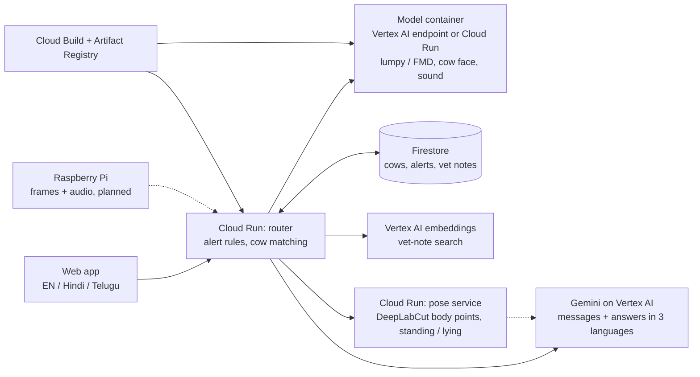

# GoMitra: what is built

## Pieces
| Piece | Where | Notes |
|---|---|---|
| Web app and API | Cloud Run `gomitra` (Mumbai) | One service. Serves the app and `/api/*`. Scales to zero. |
| Models | **Vertex AI endpoint** `cattle-endpoint` (model `cattle-serving-v4`, n1-standard-2, Mumbai) | Live. The same container is also on Cloud Run `cattle-serving` (scales to zero) as a fallback: `deploy/switch_backend.ps1 cloudrun` switches the app to it. Chosen by the `INFER_BACKEND` setting. Stateless. |
| Pose and posture | Cloud Run `gomitra-pose` (4 CPU, 8 GB) | DeepLabCut SuperAnimal-Quadruped, weights baked into the image. About 17 seconds per request on CPU. Private; the router calls it with a service identity. |
| Walking score | Gemini on Vertex AI | Sprecher 1 to 5 scale, with a trust gate: no score if the picture is not clear. Falls back to pictures only if the pose service is down. |
| Data | Firestore (Mumbai) | `cows`, `observations`, `alerts`, `audio_events`, `kb_chunks` |
| Messages, answers | Gemini 2.5 Flash on Vertex AI | Fixed templates in all three languages are used if Gemini fails. |
| Vet-note search | Vertex AI embeddings (`gemini-embedding-001`) | Multilingual, so a Telugu question finds an English passage. |
| Builds | Cloud Build, Artifact Registry | No local Docker needed. |
| Identity | Service account `gomitra-router` | Roles: Firestore user, Vertex AI user, invoker of the model service. |

## The Raspberry Pi entry point (the router's dispatcher)
The Pi runs `pi/gomitra_pi.py`: it captures a photo and a short sound clip on a schedule and uploads each to one address, `POST /api/ingest`, with a device key. It runs no AI.
The router looks at the first bytes of the file to see what it is and sends it on with fixed rules (no model guesses where a file goes):
- **photo or short video: the frame agent** (`router/gomitra/domain/agent.py`, checks ported from the team's `frame_extraction.py`). A video is read at about 3 frames a second (at most 24). Cheap checks drop dark, blurred and near-duplicate frames; the cow detector and the cow-face finder look at the best 8; then each frame is routed: a clear face goes to the cow-face model (who is it?); a clearly visible cow goes to the skin model and the alert rules; a cow that is side-on, fully visible, not blocked by another cow and big enough goes to the pose model and Gemini for a walking/resting check (best 5 frames, at most every 10 minutes per cow, and the sighting is kept for the habit trends). Frames that fail every check reach no model, which saves cost and avoids false alerts.
- **sound clip:** distress and eating-sound models, then alert rules.
Each upload, what the agent decided and why is logged (last 50) and shown on the "How it works" screen. Files that cannot be read are refused. If the Pi is offline, it keeps files and sends them later.

## How a photo is handled
1. The app sends the photo. The router shrinks it and sends it to the models for two things: skin screening and cow-face detection.
2. If the cow is not chosen, the router matches the face to registered cows in Firestore. Ear-tag OCR is a slower fallback.
3. Alert rules: a skin finding needs 60% or more. Photos alert at once. Camera frames need two agreeing sightings out of the last five.
4. If it alerts, the router searches the vet notes and asks Gemini for a short message and three steps in English, Hindi and Telugu, citing the note. The cow's record in Firestore is updated.

## Switching between Vertex AI and Cloud Run
`deploy/switch_backend.ps1 vertex <endpoint id>` or `deploy/switch_backend.ps1 cloudrun`. The app does not change.

## Showing that it is real: "Behind this result"
Every request carries a measured trace (module `router/gomitra/core/tracing.py`): each call to the Vertex AI endpoint, Gemini, the embeddings, the pose service and Firestore is timed where it happens, and the app shows the list under every result. Nothing in it is typed by hand; a failed or fallback step says so.

## Safety and cost limits
- **Public by design:** the app URL is open so the jury can try it. The sign-in screen is a demo screen, not real authentication. The model and pose services are private; only the router's service account can call them.
- **Admin routes** (load or delete vet documents, seed demo data, delete a cow) need a secret key header.
- **Per-visitor rate limit** in the router: for example 20 walking checks, 30 photo checks and 15 vet reports per minute per address. Over the limit the app gets a "wait a minute" reply (HTTP 429).
- **Instance caps** on Cloud Run: router 4, models 2, pose 1, so a flood cannot scale the bill without limit.
- **Budget alerts:** emails at 50%, 90% and 100% of INR 2,000 for this project (before credits), plus the existing INR 3,000 account budget. Budgets warn; they do not stop spending.

## Keeping the demo fresh
- The simulated week of habit data (Tulasi resting more, group chewing down, Nandini's rising walking score) is rebuilt automatically when someone opens the app and it is more than 8 hours old. Turn off with the setting `AUTO_DEMO=0`.
- `POST /api/demo/reset` (admin key) returns the demo to a clean state: clears alerts, history, sound events and device logs, removes cows added during testing (add `?keep_cows=true` to keep them), reloads the 6 demo cows and the simulated week. Vet documents are kept.

## Cost notes
Cloud Run router and Firestore: close to nothing when idle. Model container: kept at one running instance for the demo (a few rupees per hour). Pose service: scales to zero; keeping one instance warm costs roughly 35 rupees per hour, so only do it during the demo. Vertex AI endpoint: about 10 rupees per hour while deployed. Undeploy it after the demo.
