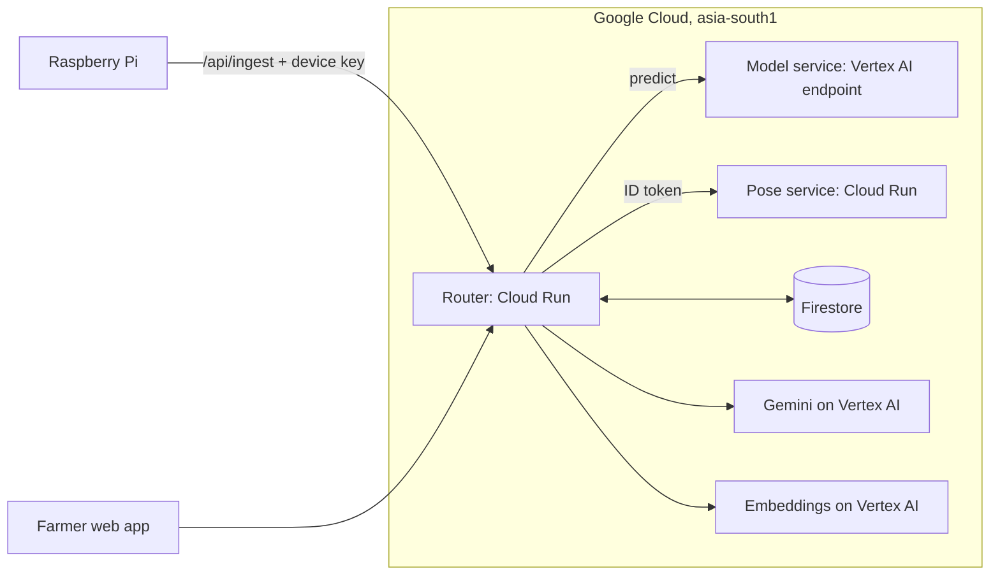
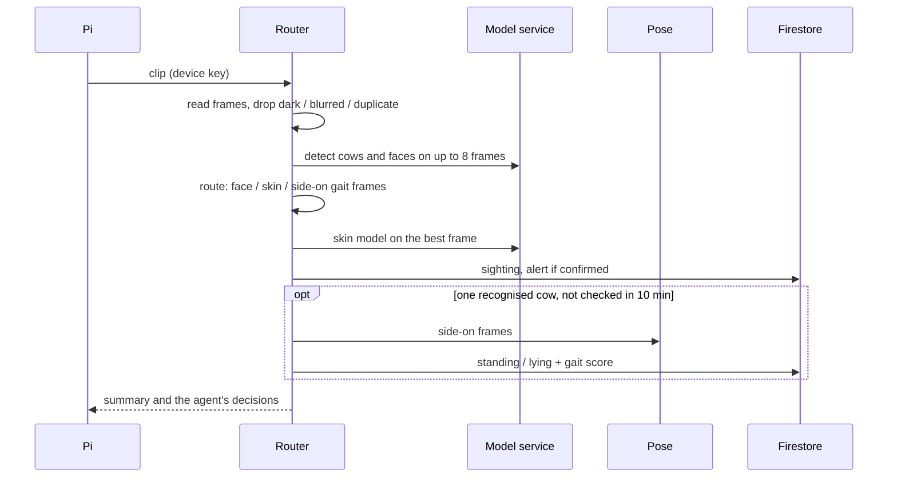

# GoMitra: high-level design

## 1. Goal and constraints
Screen cattle health early and tell the farmer what to do next, in English, Hindi and Telugu. A Raspberry Pi only captures and uploads;
all AI runs on Google Cloud. Must run cheaply (scale to zero), tolerate Gemini or a model being down, and never present a screening
hint as a diagnosis.

## 2. Components
| Component | Responsibility | Google Cloud |
|---|---|---|
| Web app (`frontend/`, served by the router) | Farmer screens, voice, three languages | Cloud Run |
| Router (`router/gomitra`) | API, alert rules, habit trends, frame agent, vet assistant, demo data | Cloud Run |
| Model service (`serving/`) | Skin, cow-face, ear-tag and sound models behind one `/predict` | Vertex AI endpoint (Cloud Run as fallback) |
| Pose service (`pose/`) | Body points, standing/sitting/lying | Cloud Run (scales to zero) |
| Gemini 2.5 Flash | Alert text in three languages, walking score, vet report, grounded answers | Vertex AI |
| Embeddings | Multilingual search of the vet documents | Vertex AI (`gemini-embedding-001`) |
| Data | Cows, alerts, sightings, sound events, vet-document pieces | Firestore |
| Raspberry Pi uploader (`pi/`) | Capture photo, clip, sound; upload | none |
| Build and delivery | Container builds, images | Cloud Build, Artifact Registry, IAM |

## 3. Deployment view

## 4. Main flows
**Photo from the farmer.** App -> `/api/analyze` -> model service (skin + cow face) -> match the cow -> alert rules -> if confirmed,
Gemini writes the message from vet-document passages -> cow updated in Firestore -> app shows result and the services used.

**Camera upload.** Pi -> `/api/ingest` -> the frame agent drops bad frames and routes the rest: face -> cow-face model, clear cow -> skin
model and alert rules, side-on cow -> pose model and walking check -> sightings feed the habit trends.

**Sound alert.** Clip -> call-type and eating-sound models -> distress alert (or chewing far below usual) -> the router ranks the
cows of that camera group by recent inactivity -> the alert ends with "check this cow first" or says it could not tell.

**Ask GoMitra.** Question -> embedding -> similarity search over stored document pieces (in the router) -> Gemini answers only from
those pieces, names sources, or says it does not know.

## 5. Data model (Firestore)
`cows` (profile, alert, signals, face embeddings) - `observations` (skin checks) - `posture_log` (standing/sitting/lying + gait
sightings) - `audio_events` (sound clips) - `alerts` (distress and group eating) - `kb_chunks` (vet-document pieces + vectors) -
`ingest_log` (last 50 device uploads) - `meta` (demo data timestamp).

## 6. Quality attributes
| Attribute | How |
|---|---|
| Cost | Router and pose service scale to zero; model service on one Vertex machine; per-visitor rate limit; instance caps; budget alerts |
| Resilience | Gemini down -> fixed templates; pose down -> Gemini-only gait; Vertex down -> switch to the Cloud Run model service |
| Safety | Screening wording only; no drug names or doses; unknown questions go to a vet; thresholds documented |
| Security | Private model and pose services; admin and device keys; rate limit; security headers |
| Observability | Every result shows the services used and measured times ("Behind this result") |
| Testability | Layered code; pure rules; 150+ automated tests (see `LLD.md`) |

## 7. Known limits
Skin model validated on clear photos only (95.9% on 614), not on camera footage or early disease. Sound models unvalidated on farms.
Habit-trend history in the demo is simulated. Sound cannot say which cow made it, so the cow to check first is inferred from cameras.
